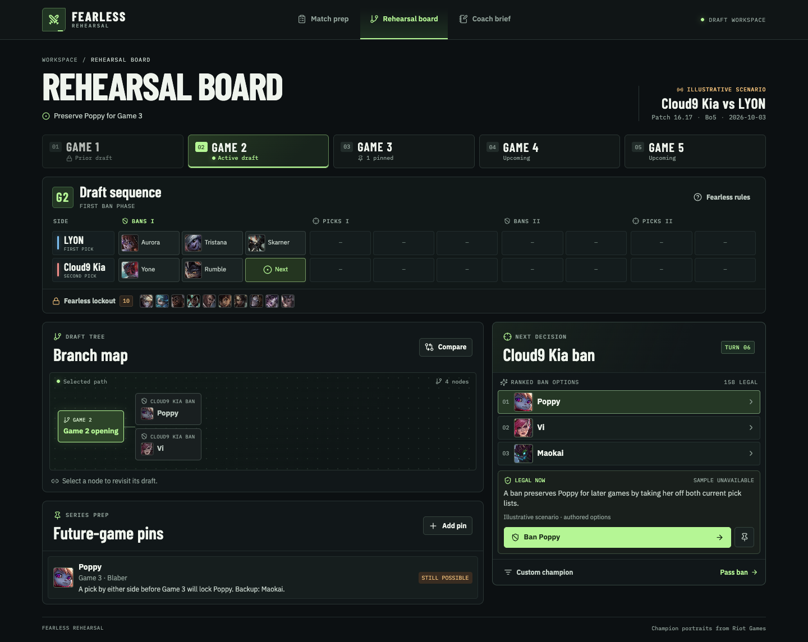

# Fearless Rehearsal

A League of Legends coach can fork a pick or ban during prep, see the opponent’s likely replies, and trace what happens to a champion reserved for a later game. The board keeps the draft order, both teams’ locks, each branch and its coach notes together. Built for the League of Legends Macro Scouting & Draft Management category of the Cloud9 × JetBrains hackathon.



## Run the board

From a checkout, run the following command with Python 3.11+ and Node.js 22 installed. It creates a virtual environment, builds the frontend, starts FastAPI and serves the board at [localhost:8000](http://localhost:8000).

```sh
./scripts/start.sh
```

GitHub Codespaces can also run the repository’s dev container. After setup, open forwarded port 8000. [Open in Codespaces](https://codespaces.new/Anton15K/fearless-rehearsal)

For a static standalone build, run `npm --prefix web ci` and `npm --prefix web run build:demo`, then `python3 -m http.server 8002 --directory web/dist-demo`. Open [localhost:8002](http://localhost:8002). This edition runs the same Python draft rules inside a browser worker and saves plans in that browser’s IndexedDB. The runtime, draft data and public forecast are served from the build directory. Champion portraits load from Riot when available.

## Rehearse a decision

For an upcoming series, choose **Match prep → New matchup**. Enter both teams, your coaching side, first pick, as-of date, patch and series format. Add a roster override if needed. The board starts at Game 1 with no actions or series locks. Known team and player identities come from games completed before the selected date.

1. Open the illustrative Cloud9 Kia–LYON board. It starts at Cloud9’s last ban of the first ban phase in Game 2. Blaber has Poppy pinned for Game 3.
2. Choose the **Poppy** ban. Neither team can pick her in Game 2. The ban expires at the game boundary, so the Game 3 pin is protected.
3. Return to the opening position and ban **Vi**. Poppy stays available. Explore LYON picking Poppy, then compare the two branches. The same pin now shows a conflict because either team’s pick locks the champion for the remainder of the series.
4. Save a backup and attach a note to the branch in **Coach brief**. Reopen the plan from **Match prep**. Server-backed plans use SQLite and a browser-specific cookie. Clearing that cookie removes access from that browser.
5. In **Match prep**, choose the historical Cloud9–Dignitas replay. Follow the recorded actions or fork at any turn. Replay can advance along any branch that still matches the recorded draft prefix.

## What the rankings mean

| Board | Evidence shown |
| --- | --- |
| Illustrative Poppy scenario | Authored coaching options that demonstrate the rules and pin outcomes. |
| Historical board in a public checkout | An independently fitted LCS frequency model. It shows estimated probabilities, available historical support, and conditional paths. |
| Historical board with the private evaluated bundle | A model ranking of legal choices at this turn, with evidence dates and calibrated probabilities when available. On opponent turns, the board can expand one or two replies and group consecutive picks in either order. |

The top three are three candidates for **one next action**. A path combines successive forecasts and stops at the coach’s next decision. The board displays how much probability the visible paths cover and how much lies outside them. It does not estimate which team wins the match.

On 238 held-out pro games, the serving models put the actual next champion in the top three on **38.45% of picks** and **37.86% of bans**. The dated frequency baseline scored 20.42% and 30.50%. [Dataset, evaluation and training instructions](docs/methodology.md)

## Project map

| Source | Responsibility |
| --- | --- |
| `web/src/` | React and TypeScript draft board, matchup setup, branch comparison, pinning and coach brief |
| `fearless/rules.py`, `fearless/outlook.py` | Draft turns, champion legality, series locks, pin evaluation and conditional path expansion |
| `fearless/api.py`, `fearless/rehearsal.py` | FastAPI endpoints and persisted rehearsal trees |
| `fearless/data.py`, `fearless/grid.py`, `fearless/roles.py` | Feed normalization, audit and historical role evidence |
| `fearless/model*.py`, `cluster/train.sbatch` | As-of-date features, training, calibration, evaluation and GPU job |

The public checkout includes an independently licensed historical replay. Official feeds, derived rows and the trained bundle stay in participants’ private environments. Source code is MIT licensed. The data and Riot assets have separate terms. [Asset attribution](fearless/assets/NOTICE.md) · [GRID license](https://github.com/cloud9esports/stl-hackathon-2026-grid-starter/blob/main/LICENSE.md)

## Verify a checkout

```sh
python3 -m venv .venv
.venv/bin/python -m pip install -e '.[data,model,test]'
.venv/bin/python -m pytest -q
npm --prefix web ci
npm --prefix web test
npm --prefix web run build
```

The automated checks run on pull requests. The team also used PyCharm’s command-line inspections on the draft-rule module and its bundled pytest runner on the integrated backend. [Build and verification notes](docs/methodology.md#development-and-verification)
